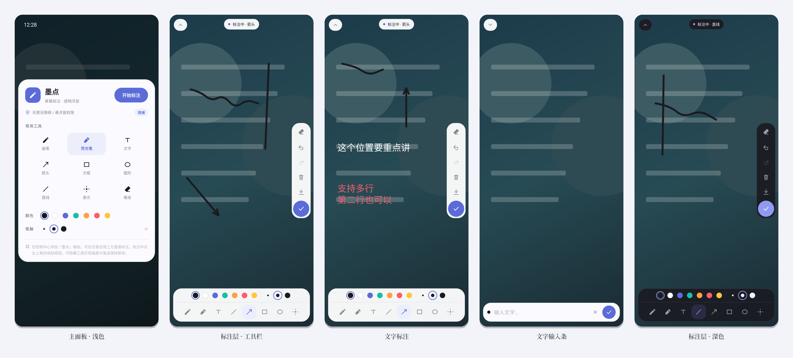
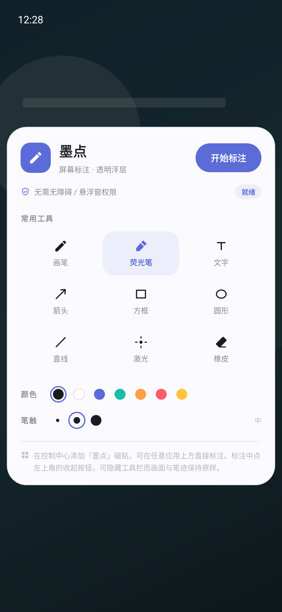
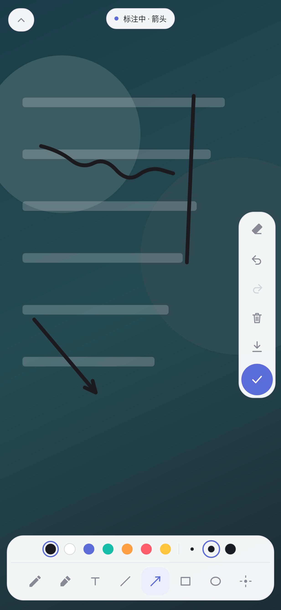
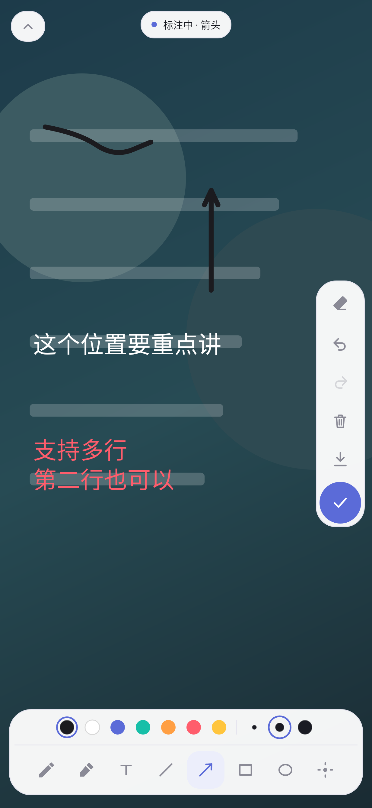
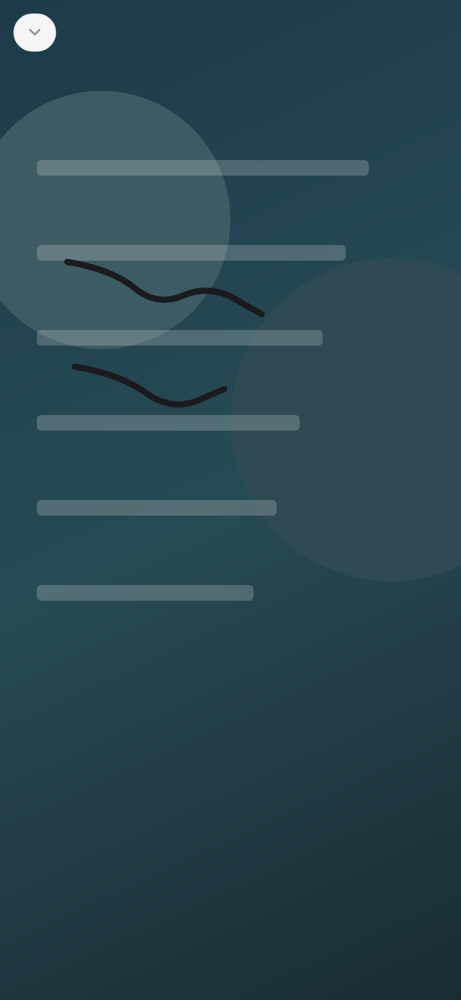
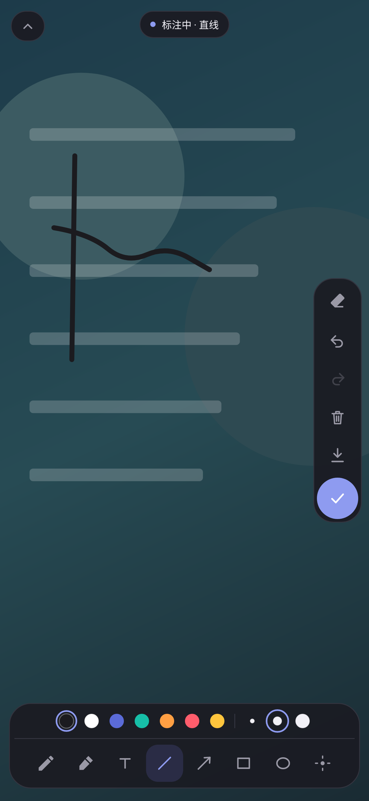
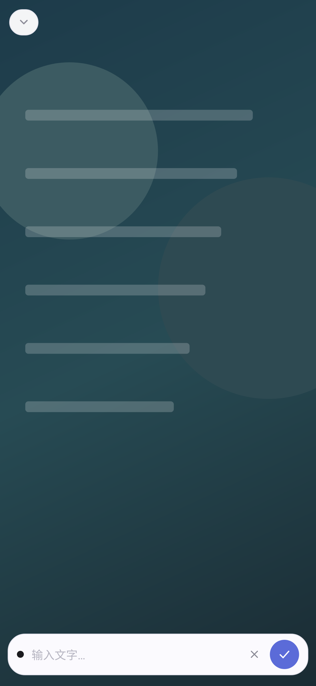

# 墨点 · InkMark

> 安卓屏幕标注工具。不申请悬浮窗权限、不使用无障碍服务，靠**透明背景的 Activity** 把标注层直接盖在当前画面之上。



墨点可以直接在任意应用之上涂鸦、勾画、圈重点、画箭头，结束后原样返回。整个应用只有 **710 KB**，零运行时依赖（无 Kotlin、无 AndroidX、全部 Java + 自绘 View）。

## 为什么不用悬浮窗

常见的屏幕标注 / 录屏工具都要走 `TYPE_APPLICATION_OVERLAY` 悬浮窗，代价是需要「显示在其他应用上层」权限，还要过各家 ROM 的二次开关；也有走无障碍服务的，代价是常驻后台 + 隐私顾虑。

墨点换了一条路：**把标注界面做成一个全透明的 Activity**。窗口背景透明、不加 dim，下层应用的内容原封不动地透出来，视觉上与悬浮窗几乎一致，但完全走系统正常的 Activity 生命周期。

| | 传统悬浮窗方案 | 墨点 |
|---|---|---|
| 实现 | `TYPE_APPLICATION_OVERLAY` | 透明 `Activity`（`windowIsTranslucent=true`） |
| 权限 | 悬浮窗权限，需用户在设置里单独开启 | 无任何特殊权限 |
| 服务 | 常驻前台/后台服务 | 无常驻服务，磁贴一点即起 |
| 系统行为 | 需自行处理旋转、分屏、insets | 直接复用系统窗口体系 |

主面板则是另一种窗口：`Theme.DeviceDefault.Light.Dialog` + `windowIsFloating=true` + `windowIsTranslucent=true`，得到系统原生的浮动弹窗观感——没有启动窗、没有 SplashScreen、没有缩放转场，界面外完全透明。

## 功能

- **9 种工具**：画笔（二次贝塞尔平滑）、荧光笔、**文字**（点哪写哪，支持多行）、直线、箭头、方框、圆形、激光笔（逐帧淡出）、橡皮（按笔画/文字块命中擦除）
- **7 色 × 3 档笔触**，主面板里选的默认值会带进标注层
- **撤销 / 重做 / 清空**：快照式历史栈，40 步
- **保存为透明 PNG**：`Pictures/墨点`，Android 10+ 走 MediaStore，低版本自动申请存储权限
- **控制中心磁贴**：一次性动作型，点一下直接唤起标注，不会留下"已开启"的误导状态
- **一键收起工具栏**：左上角倒 V 按钮，收起后只剩画面与笔迹，仍可继续书写
- **后台不留痕**：主面板与标注层都 `excludeFromRecents`，多任务列表里从不会出现墨点
- **切出即擦除**：回到桌面 / 切换应用 / 点完成，笔迹与撤销历史立即清空，下次是白纸一张
- **完整深色模式**，配色跟随系统

## 截图

| 主面板 | 标注层 | 文字标注 | 收起工具栏 | 深色模式 |
|---|---|---|---|---|
|  |  |  |  |  |

文字模式点一下画布，底部会升起输入条（键盘弹起时自动贴在其上方），确认后文字落成一条墨迹，可撤销、可擦除、可随图片一起导出：



## 安装

到 [Releases](../../releases) 下载最新的 `InkMark-*.apk` 直接安装：

```
adb install InkMark-1.1.apk
```

- 最低 Android 7.0（API 24），targetSdk 34
- 不申请任何危险权限；保存图片时才在 Android 9 及以下申请存储权限

## 使用

1. 打开墨点，选好默认工具 / 颜色 / 笔触，点「开始标注」即可在**当前画面**上标注。
2. 想标注任意应用：下拉控制中心 → 编辑磁贴 → 把「墨点」拖进快捷开关 → 在目标应用界面点一下磁贴。
3. 标注中：左下角面板切工具，右侧操作列撤销 / 保存 / 完成；点左上角倒 V 收起工具栏。
4. 用「文字」工具点画布任意位置 → 底部输入条输入（支持换行）→ 点 ✓ 落字；字号跟随当前笔触档位，颜色跟随当前色。
5. 「完成」退出标注层，回到原来的应用；一旦切出，涂鸦内容自动清空。

## 项目结构

```
app/src/main/java/com/inkmark/app/
├── MainActivity.java      主面板（浮动 Dialog 窗口）
├── AnnotateActivity.java  标注层（全屏透明窗口）+ 工具栏装配
├── CanvasView.java        绘制引擎：笔迹、图形、文字、激光、橡皮、导出
├── Ink.java / Tool.java   笔迹数据模型与工具定义
├── History.java           快照式撤销栈
├── Geom.java              几何命中（点到线段/矩形边界距离）
├── InkTileService.java    控制中心磁贴（动作型）
├── PngExporter.java       墨迹层导出透明 PNG
├── ToolButton.java / DotView.java / Ui.java  自绘控件与尺寸工具
└── Prefs.java             偏好存储
```

窗口观感的关键都在 `res/values/styles.xml` 与两个主题里：

| | 主面板 `Theme.InkMark.Card` | 标注层 `Theme.InkMark.Overlay` |
|---|---|---|
| 父主题 | `Theme.DeviceDefault.Light.Dialog` | `Theme.DeviceDefault.Light.NoActionBar` |
| 窗口背景 | 透明 | 透明 |
| `windowIsFloating` | `true` | `false` |
| `windowIsTranslucent` | `true` | `true` |
| 窗口动画 | 自写 `popup_in`（alpha + 上浮 18dp / 220ms，无 scale） | 同左 |
| 背景遮罩 | 卡片外透明，不压暗 | 不压暗 |

卡片圆角、留白、阴影全部自绘（`bg_card` + `elevation`），所以不受各 ROM 的 `dialogCornerRadius` 影响。

## 从源码构建

需要 JDK 17 与 Android SDK（Platform 35 + Build-Tools 35.0.0）。

```bash
echo "sdk.dir=/path/to/Android/sdk" > local.properties
./gradlew assembleDebug
```

release 包默认用 debug 签名（仓库不含签名文件）。要用自己的密钥签名：

```bash
./gradlew assembleRelease \
  -PINKMARK_STORE_PASS=你的密码 \
  -PINKMARK_KEY_PASS=你的密码
```

并把密钥库放到项目根目录的 `inkmark.jks`、`keyAlias` 默认 `inkmark`（可用 `-PINKMARK_KEY_ALIAS=` 覆盖）。

## 测试

没有真机/模拟器也能跑：用 Robolectric 在 JVM 里真实创建 Activity、inflate 布局、派发触摸事件，并把界面渲染成 PNG。

```bash
./gradlew testDebugUnitTest
```

共 33 个用例，覆盖几何命中、撤销栈、窗口主题属性（`windowIsFloating` / `windowTranslucent` / 无 dim）、触摸绘制与撤销、工具栏收起/展开、切出即擦除、文字插入/空输入拦截/橡皮擦文字块、磁贴状态。渲染出的预览图在 `app/build/ui-preview/`。

## 已知限制

- 标注层是 Activity，会**接管触摸**：标注时下层应用看得见但点不动。适合讲解、圈画、截图批注；想要「边滑边画」仍然只能回到悬浮窗方案。
- 从桌面图标进入时，标注层下面是桌面。要标注某个 App，请用控制中心磁贴入口。
- 磁贴是一次性动作，不提供「关闭标注」能力，退出请在标注层点「完成」。
- 「切出即擦除」是刻意的取舍：切到别的应用再回来，画布是空的，不能接着改上一张图。需要保留请先点保存导出 PNG。
- 文字落笔后不能再编辑内容，只能整块擦掉重写（撤销可以逐步回退）。

## License

[MIT](LICENSE) © 2026 sswz666
